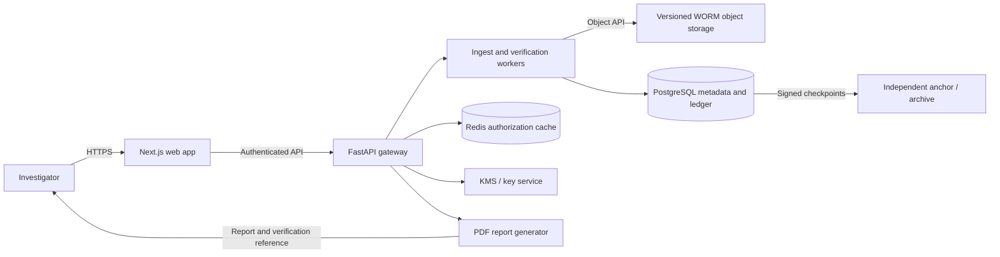

# TRACE — Solution Architecture

**Project:** Digital Evidence Vault (PS 18)  
**Document status:** Proposed  
**System name:** TRACE

## 1. Executive summary

TRACE is a digital evidence vault intended to preserve evidence, record its chain of custody, and make later integrity checks repeatable. Its design combines independent content hashing, versioned object storage with retention controls, access controls, and an append-only, hash-linked audit ledger.

The trust model is deliberately layered: no single hash, database, administrator, or storage service is treated as sufficient proof on its own. Cryptographic checks can show that bytes match a recorded digest; they do not, by themselves, prove who originally collected the evidence, that the collection process was lawful, or that a court will admit it. Those claims require documented operational procedures, identity controls, reliable timestamps, and jurisdiction-specific legal review.

## 2. Goals and non-goals

### Goals

- Preserve the original evidence bytes and record a SHA-256 digest at ingest.
- Independently verify the stored object against the recorded digest.
- Record ingest, access, export, verification, and administrative events in a tamper-evident audit trail.
- Enforce least-privilege access and retention controls.
- Produce a verifiable evidence report with provenance, custody events, and integrity results.
- Support both private/air-gapped deployments and cloud object storage.

### Non-goals

- TRACE does not independently establish the legality or authenticity of evidence at collection.
- A hash match does not prove that the original evidence was genuine or that it was not altered before ingest.
- WORM retention and a database hash chain do not make all forms of administrator tampering impossible.
- Generated reports are not automatically legally admissible or compliant; local counsel and procedural requirements govern.

## 3. Architecture principles

1. **Preserve originals:** Store evidence as received. Extracted metadata is supplemental and must not modify the original.
2. **Verify independently:** The client and server calculate hashes independently; server-side verification remains authoritative for stored content.
3. **Separate duties:** Application, database, storage, and key-management privileges are distinct. Administrative access is itself auditable.
4. **Make audit evidence verifiable:** Define canonical ledger serialization and periodically anchor signed ledger checkpoints outside the primary database trust boundary.
5. **Fail explicitly:** Distinguish an integrity mismatch from an unavailable storage service or an incomplete verification.
6. **Minimize sensitive data:** Restrict evidence metadata and report access; avoid putting evidence content or secrets in logs.

## 4. High-level architecture



### Components

| Tier | Proposed technology | Responsibility |
|---|---|---|
| Web application | Next.js / React | Authenticated user interface; calculates a client-side digest and displays upload and verification status. |
| API gateway | Python / FastAPI | Authentication and authorization, upload coordination, evidence metadata, verification and report endpoints. |
| Processing | Python workers | Stream hashing, metadata extraction, storage operations, report generation, and retryable background work. |
| Metadata and ledger | PostgreSQL | Cases, evidence records, authorization references, ledger events, and transactional state. |
| Authorization cache | Redis (optional) | Short-lived cache for authorization decisions. PostgreSQL or the identity provider remains the source of truth. |
| Evidence storage | AWS S3 Object Lock or MinIO | Versioned evidence objects with configured retention and encryption. |
| Key management | AWS KMS or an approved on-premises KMS | Key creation, rotation, access separation, and encryption-key policy. |
| PDF generation | Server-side PDF renderer | Fixed-layout reports containing evidence identifiers, hashes, custody events, and verification results. |

## 5. Evidence ingest and verification

### Ingest flow

1. The user authenticates, selects a case, and submits a file. The application calculates the client digest using a vetted streaming SHA-256 implementation. The browser's native `SubtleCrypto.digest()` API is not incremental, so large files must not be loaded wholly into browser memory; use a reviewed streaming/WASM implementation or an explicitly bounded strategy.
2. The API validates the user's case-level permissions, request size, file type policy, and idempotency key. It streams the upload over TLS to a restricted staging area while independently calculating SHA-256.
3. The server compares its digest with the client-supplied digest. A mismatch rejects the ingest and records the outcome; a match is evidence of transfer consistency, not proof of pre-upload authenticity.
4. The service writes the exact original bytes to versioned object storage, applies the configured retention lock, and records the immutable object key and version ID. It must not rely on an S3 multipart ETag as the SHA-256 digest.
5. The service extracts permitted metadata into a separate record. Extraction failures are recorded and do not alter or discard the original.
6. In one database transaction, the service creates the evidence record and the genesis ledger event. A recoverable ingest state machine and reconciliation job handle failures between object storage and PostgreSQL; these systems do not share a distributed transaction.
7. The API returns the evidence ID, recorded digest, storage version reference, and ingest status.

### Verification flow

1. The API authorizes the requester and resolves the exact stored object version.
2. A worker streams the object and recalculates SHA-256 without changing it.
3. TRACE compares the result with the digest recorded at ingest and records the verification event.
4. The API returns `PASS` for a completed match, `FAIL` for a completed mismatch, or an explicit unavailable/error response if verification could not complete. An outage must never be reported as `FAIL` or `PASS`.

## 6. Storage and cryptography

- Use TLS for all client, service, and storage connections. Prefer TLS 1.3; allow only policy-approved alternatives where a component cannot support it.
- Encrypt stored evidence using managed or independently controlled keys (for example, S3 SSE-KMS or a MinIO-compatible KMS). Define key rotation, backup, recovery, and access policies separately from object retention.
- Enable bucket versioning and Object Lock before ingest. Configure retention mode and duration according to policy; Compliance mode and Governance mode have different administrative override properties.
- Record the exact object version ID. Protecting a version does not automatically prevent creation of a new version or protect other objects.
- Store evidence objects and derived reports separately. Reports must not be mistaken for original evidence.
- SHA-256 is used for content integrity. The client digest is an input claim; the independently computed server digest is the recorded ingest value.

## 7. Audit ledger

### Event model

Each event records an evidence identifier, action, actor, event time, relevant content digest, metadata, previous event hash, and current event hash. Event types include `INGEST`, `VIEW`, `EXPORT`, `VERIFY`, and relevant administrative or denied-access events.

The hash must be calculated over a versioned, unambiguous canonical representation. Do not concatenate variable-length strings without framing. A proposed construction is:

```text
current_hash = SHA-256(
  "TRACE-LEDGER-v1" || 0x00 ||
  canonical_json({
    sequence,
    event_id,
    evidence_id,
    previous_hash,
    action_type,
    actor_id,
    file_sha256,
    timestamp_utc,
    metadata
  })
)
```

The canonical JSON profile, character encoding, timestamp precision, null handling, and field ordering must be fixed and versioned. Ledger appends must serialize access to the chain head in a database transaction to avoid concurrent events sharing or skipping a predecessor.

A hash chain stored only in PostgreSQL is not sufficient to defeat a privileged database operator: an operator able to rewrite every row can recalculate the chain. Restrict direct writes, separate database administration from application operations, and periodically sign and export ledger checkpoints to a separately controlled account or archival system. The report should state the most recent externally anchored checkpoint relevant to its events.

### Illustrative schema

The following is a logical starting point; production migrations must define all referenced tables, constraints, indexes, retention behavior, and transaction logic.

```sql
CREATE TABLE evidence_ledger (
    sequence BIGINT GENERATED ALWAYS AS IDENTITY PRIMARY KEY,
    event_id UUID NOT NULL UNIQUE,
    evidence_id UUID NOT NULL REFERENCES case_files(id),
    previous_block_hash CHAR(64) NOT NULL,
    action_type VARCHAR(50) NOT NULL,
    actor_id UUID NOT NULL REFERENCES users(id),
    file_sha256_hash CHAR(64) NOT NULL,
    metadata JSONB NOT NULL DEFAULT '{}'::jsonb,
    occurred_at TIMESTAMPTZ NOT NULL,
    hash_version SMALLINT NOT NULL DEFAULT 1,
    current_block_hash CHAR(64) NOT NULL UNIQUE
);
```

`occurred_at` should be assigned by a trusted server-side time source and treated as an asserted system time, not an independently certified timestamp. Consider a separate per-chain head table and externally signed checkpoints when implementing concurrent writes and anchoring.

## 8. Identity, authorization, and administration

- Use a managed identity provider or an established authentication mechanism with MFA for privileged users.
- Enforce role- and case-level authorization on every API operation; do not rely solely on UI checks or cached permissions.
- Cache authorization decisions only briefly and invalidate them when role or case access changes.
- Keep evidence access separate from infrastructure administration and key-management privileges. “Blind admin” is a goal of separation, not an absolute guarantee; document and audit break-glass access.
- Record successful and denied sensitive actions, including views, exports, verification requests, retention changes, and administrative operations.
- Apply least privilege to service identities, storage policies, database accounts, and report links.

## 9. Core API

All endpoints require authentication and authorization. Request and response schemas, maximum upload sizes, rate limits, and error formats are defined in the API implementation.

### Upload evidence

`POST /api/v1/evidence`

Accepts `multipart/form-data` containing the file, client SHA-256 digest, case identifier, and permitted metadata. Require an idempotency key for safe retries.

- `201 Created`: ingest completed; returns evidence ID, digest, and status.
- `202 Accepted`: asynchronous ingest is still in progress.
- `400 Bad Request`: invalid input or digest format.
- `403 Forbidden`: caller lacks case access.
- `409 Conflict`: digest mismatch or idempotency conflict, with a non-sensitive error code.
- `5xx`: storage or processing failure; return a correlation ID and record the failure.

### Verify evidence

`GET /api/v1/evidence/{evidence_id}/verify`

Streams the exact stored version and compares its recalculated SHA-256 with the ingest digest. A completed check returns a result such as:

```json
{
  "evidence_id": "c39e4a82-16b2-4d91-8b3f-1d8d214a1e90",
  "status": "PASS",
  "genesis_hash": "e3b0c44298fc1c149afbf4c8996fb92427ae41e4649b934ca495991b7852b855",
  "computed_hash": "e3b0c44298fc1c149afbf4c8996fb92427ae41e4649b934ca495991b7852b855",
  "verification_timestamp": "2026-10-27T05:09:30Z"
}
```

An unavailable storage object or incomplete computation returns an explicit error, not a successful verification result.

### Generate report

`GET /api/v1/evidence/{evidence_id}/report`

Validates the applicable ledger chain and generates a PDF containing the evidence identifier, original digest, object-version reference, custody events, verification result and time, and checkpoint/anchor details when available. Return `application/pdf`; for long-running reports, the endpoint may return a job ID and a separately authorized download link.

The QR code should contain a non-secret report/evidence verification reference, not evidence bytes, credentials, or unrestricted access. The report should be digitally signed when the signing-key policy is established. A generated certificate is a technical record, not a guarantee of legal admissibility.

## 10. Deployment options

| Concern | RustFS (local development) | MinIO (private deployment) | AWS S3 |
|---|---|---|---|
| Best fit | Local development and S3 API integration tests | Private infrastructure or disconnected deployments | Managed cloud and elastic enterprise deployments |
| Main advantages | S3-compatible API and Object Lock support for local testing | Data sovereignty and deployment flexibility | Managed durability, scaling, and native Object Lock integration |
| Operational considerations | The single-drive Compose setup is not production-grade durability or a security boundary | The operator owns availability, upgrades, replication, monitoring, and key management | Requires connectivity, cloud-account controls, cost management, and region/data-residency review |
| Recommendation | Use only for local development; validate behavior against the actual production provider | Use for approved on-premises/air-gapped deployments | Use for cloud production where policy and jurisdiction permit |

Keep the storage interface provider-neutral, but validate Object Lock semantics, retention configuration, version handling, and encryption behavior against each target provider before migration.

For a single-agency deployment, PostgreSQL can provide the initial ledger. For multi-organization custody, a permissioned ledger such as Hyperledger Fabric may be evaluated if participants need shared governance and independent validation. A blockchain does not remove the need for correct identity, collection procedures, key custody, or off-ledger evidence preservation.

## 11. Reliability and operational controls

- Use encrypted backups, point-in-time database recovery, and tested restoration procedures. Backups must preserve ledger consistency and evidence-to-object references.
- Run reconciliation for incomplete ingests, orphaned objects, missing object versions, and ledger/database inconsistencies.
- Monitor upload failures, digest mismatches, verification errors, retention status, queue delays, and checkpoint freshness.
- Use immutable deployment artifacts and controlled configuration changes; audit changes to retention, keys, identities, and service policies.
- Define retention, legal hold, export, deletion-after-retention, disaster recovery, and incident response procedures before production.
- Avoid logging evidence content, credentials, raw authorization tokens, or unnecessary personal metadata.

## 12. Key risks and mitigations

| Risk | Mitigation |
|---|---|
| Evidence was altered before ingest | Document collection procedures and source provenance; ingest hashes cannot establish pre-ingest authenticity. |
| Privileged operator rewrites database history | Restrict direct writes, separate duties, sign and externally anchor ledger checkpoints, and audit privileged actions. |
| Incorrect client/server hashing of large files | Use vetted streaming implementations and test known vectors, boundaries, and interrupted uploads. |
| Object version or retention misconfiguration | Validate versioning and lock policy at deployment; record version IDs and continuously monitor retention. |
| Storage/database partial failure | Use explicit ingest states, idempotency, reconciliation, and alerting. |
| Key loss or unauthorized decryption | Separate key administration, define recovery and rotation, and test restore procedures. |
| Metadata or report exposes sensitive information | Minimize fields, enforce case authorization, audit exports, and use non-secret QR references. |
| Legal report overstates system assurance | Obtain jurisdiction-specific legal review and clearly state verification scope and limitations. |

## 13. Compliance and acceptance

Before production, confirm applicable evidence-handling rules, privacy and retention obligations, electronic-record certification requirements, and court procedures with qualified counsel. In India, validate the currently applicable electronic-record provisions and prescribed certificate requirements; do not assume a technical PDF alone satisfies them.

Minimum acceptance checks include:

- Client and server hashes match for supported file sizes and streaming boundaries.
- A transfer mismatch is rejected and recorded.
- Verification of an unchanged object version passes; a deliberately altered test fixture fails.
- Retention and version-lock behavior is tested for each supported storage provider.
- Concurrent ledger appends produce a valid, continuous chain.
- Tampering with a ledger row is detected, and external checkpoint verification detects rewritten history covered by an anchor.
- Authorization, denied-access audit, key separation, backup restoration, and report access controls are tested.
